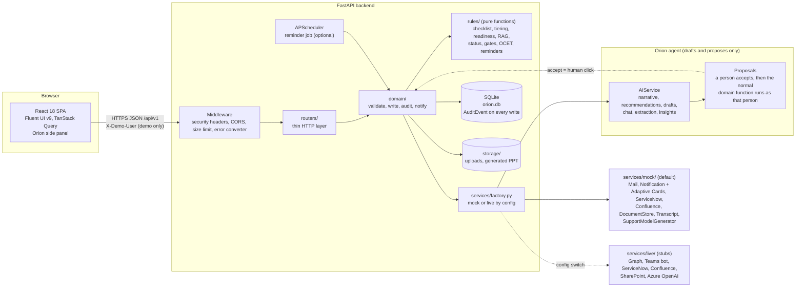

# Orion – Operate Readiness Agent (demo)

Orion is a working demo for Shell Mobility's Supportability & Transition (S&T) team. It has two parts.
The first is an Operate Readiness workspace: the system of record and workflow for every transition.
The second is an AI agent (the Orion panel) that drafts messages, recommends actions, chases owners and generates
the support model. Every external system and every AI capability in this demo is a deterministic mock behind an
interface, so the real services can be added later without changing the screens or the business rules.

> **Orion recommends and drafts. People decide.** (BR-050)
> Orion never changes a status, applicability, tier, evidence acceptance, condition, approval or gate decision.
> A permitted person clicks. Every screen labels output as either "Orion agent" (AI badge) or "Workflow rule".

- Behaviour spec: [`docs/REQUIREMENTS.md`](docs/REQUIREMENTS.md)
- Build plan, status and every assumption (A-01 to A-74): [`PLAN.md`](PLAN.md)
- Demo storyline with exact clicks (20-30 minutes): [`docs/DEMO_SCRIPT.md`](docs/DEMO_SCRIPT.md)
- Seed data: [`seed/`](seed/). Client prototype (used only to cross-check form labels): [`reference/`](reference/)

---

## 1. Quick start

### Prerequisites
- **Python 3.14 or newer.** The demo is built and tested on **3.14.7**. The target is **3.15.2**. All pinned packages
  publish Python 3.15 wheels, so moving is only a rebuild of the virtual environment (A-01). `scripts\setup.ps1`
  prefers 3.15 when it is installed and falls back to 3.14.
- **Node.js 22.12 or newer** (tested on 24.x) and npm.

### Windows (PowerShell)

Run these from the repository root.

| Script | What it does |
|---|---|
| `scripts\setup.ps1` | Creates `backend\.venv` and installs backend and frontend dependencies. |
| `scripts\dev.ps1` | Starts the API on `http://127.0.0.1:8000` (docs at `/docs`) and the web app on `http://127.0.0.1:5173`, each in its own PowerShell window. Close the windows to stop. |
| `scripts\dev.ps1 -WebPort 5174` | Same, with the web app on another port. Use this if 5173 is taken by another local app. Then open `http://127.0.0.1:5174`. |
| `scripts\test.ps1` | Backend tests, ruff and black, then frontend type-check and build, then eslint. |
| `scripts\reset.ps1` | Re-seeds the demo database. Stop the API first, or use **Admin -> Demo controls -> Reset demo data** while it runs. |
| `scripts\audit.ps1` | Dependency vulnerability scan: `pip-audit` and `npm audit`. |

First run:

```powershell
scripts\setup.ps1
scripts\dev.ps1 -WebPort 5174
```

The API seeds the database on first start when it is empty (18 transitions). Open the web address, pick a user on the
login page. There is no password.

### macOS / Linux

The `Makefile` has these targets. `PY` defaults to `python3`.

| Target | What it does |
|---|---|
| `make setup` | Creates `backend/.venv` and installs backend and frontend dependencies. |
| `make dev` | Starts the API (:8000) and the web app (:5173). Ctrl+C stops both. (`scripts/dev.sh` does the same.) |
| `make test` | Backend `pytest`, then frontend `npm run build` (type-check). |
| `make lint` | ruff and black (backend), eslint (frontend). |
| `make reset` | Re-seeds the demo database. |
| `make openapi` | Exports the OpenAPI file and regenerates the frontend API types. |
| `make audit` | `pip-audit` and `npm audit`. |

### Run a second copy next to the demo (A-66)
The Vite dev server proxies `/api` to the API. The target is `ORION_API_URL` (environment variable or
`frontend/.env`). The default is `http://127.0.0.1:8000`. To run a development copy on other ports while a demo copy
keeps 8000, set `ORION_API_URL=http://127.0.0.1:8010`, start the API on port 8010 with its own `DATABASE_URL` and
`STORAGE_DIR`, and start the web app with `npm run dev -- --port 5180`.

### Configuration: `backend/.env`
Copy `backend/.env.example` to `backend/.env` and change what you need. No secrets belong in source control (NFR-07).

| Key | Default | Meaning |
|---|---|---|
| `DEMO_MODE` | `true` | Shows **Demo controls** in Admin and enables the `/admin/demo` endpoints. Set `false` for anything that is not a demo. |
| `AI_MODE` | `mock` | `mock` or `live`. `live` is not built yet: the factory logs a warning and uses the mock (see section 5). |
| `MAIL_MODE` | `mock` | `mock` or `graph`. `graph` selects the Microsoft Graph stub, which raises "not implemented". |
| `ORION_MAILBOX` | `orion-noreply@example.com` | Sender address of Orion mail. |
| `REMINDER_JOB_ENABLED` | `false` | `true` makes APScheduler run the reminder engine every 15 minutes. |
| `SEED_DATE` | empty | Optional fixed "today" (YYYY-MM-DD) for repeatable demos. Admin can also set "today" in Demo controls. |
| `DATABASE_URL` | `sqlite:///./orion.db` | SQLAlchemy URL. Relative SQLite paths resolve against `backend/`. |
| `AZURE_OPENAI_ENDPOINT`, `AZURE_OPENAI_KEY`, `AZURE_OPENAI_DEPLOYMENT` | empty | Only for `AI_MODE=live`. |
| `MOCK_DELAY_MS` | `600` | Simulated latency of the mock services. |
| `APP_BASE_URL` | `http://localhost:5173` | Used for deep links in emails and cards. Change it if you use another web port. |
| `CORS_ORIGINS` | `["http://localhost:5173","http://127.0.0.1:5173"]` | Allowed browser origins. Add your web address if you change the port. |
| `MAX_UPLOAD_MB` | `25` | Upload size limit. Larger requests get 413. |

---

## 2. Demo users

Fictional users. Pick one on the login page; use **Switch user** in the top-right user menu at any time.

| Id | Name | Role | What they do in the demo |
|---|---|---|---|
| U01 | Asha Menon | OR focal (A) | Main presenter. Starts transitions, scopes and launches the assessment, drafts and sends chasers, edits OCET and support model, submits for review, closes conditions, records gate decisions. Owns the flagship. |
| U02-U09 | Rahul Iyer, Neha Kulkarni, Vikram Shah, Priya Nair, Arjun Rao, Kavya Reddy, Sanjay Pillai, Divya Joshi | OR focal (B to I) | Own other seeded transitions. Same rights as Asha on their own transitions only. |
| U10 | Daniel Brooks | Project manager | PM on the new SMSM Photo Capture transition. Standby user. |
| U11 | Mei Lin | Architect | Enters the missing OCET monitoring cost. Approves the support model (first review step). |
| U12 | Sofia Garcia | OLM | Approves OCET (second step), agrees the support model, approves AtD (first step). |
| U13 | Tom Becker | Planner | Approves OCET (first step). |
| U14 | Fatima Khan | IRM | Confirms the AI tier. Approves exception EX-01 and the AtD request (second step). The only IRM. |
| U15 | Laura Evans | Leadership | Read-only view of the portfolio. Sees summary tiles on the dashboard. |
| U16 | Playbook Admin | Admin | Admin pages: playbook, rules, chains, users and Demo controls (reset, fast-forward, set today, run reminder engine). |

Access is checked per transition: a role is not enough, the person must also be assigned to that role on that
transition (`backend/app/access.py`). Where a button is disabled, the tooltip says why.

---

## 3. Architecture



### Layers (PLAN.md section 4)

- **Frontend** (`frontend/src`). The UI only talks to `/api/v1` through one client (`src/api/client.ts`). TypeScript
  types are generated from the backend OpenAPI file. State is held by TanStack Query. Filters and tabs live in the URL,
  so every page has a stable deep link. The app runs inside an iframe (Teams tab later): no pop-ups, downloads use
  fetch plus a temporary link.
- **routers** (`backend/app/routers`). HTTP only: parse the request, check the permission, call a domain function,
  return a response model.
- **domain** (`backend/app/domain`). Everything that touches the database: validation using the rules, writes,
  the audit event (Human, Workflow rule, Orion agent or System), notifications. Orion proposals reuse these same functions.
- **rules** (`backend/app/rules`). Pure functions with unit tests, no database and no I/O: checklist assembly, AI tiering,
  readiness, RAG, status rules, gate validation, OCET maths, reminder triggers. This is where the business rules live.
- **services** (`backend/app/services`). Every external system and AI capability is a Python `Protocol` in
  `interfaces.py`. `factory.py` is the only place that picks a mock or live class. Mocks are deterministic and log
  `[MOCK <Service>] ...` lines.
- **Orion agent.** `AIService` produces text and structured suggestions from facts the rules computed. It has no
  write path to decisions. When Orion suggests a change (create a transition, update an item, request approval)
  it stores a proposal. `POST /orion/proposals/{id}/accept` is a human request: it runs the normal domain function
  as the signed-in user, with the note "Accepted Orion proposal <id>". A test covers this (BR-050, NFR-04).
- **Data.** SQLite for the demo. The database URL is configurable for Azure SQL or PostgreSQL later. Seed files in
  `seed/` are read in place and loaded idempotently; reset takes under 10 seconds.

---

## 4. Mock to real service mapping (spec section 10, NFR-10)

Switching to a live service must not change the routers or the UI (NFR-01). Each live class already exists as a stub
in `backend/app/services/live/`. The stub's docstring names the real call.

| Interface | Real service | What the demo does today | What the live version needs |
|---|---|---|---|
| `AIService` | Azure OpenAI / Azure AI Foundry | Template-based text filled with real data, keyword intents for chat, deterministic field extraction against reference data. No randomness. `AI_MODE=live` is accepted but the factory logs a warning and still uses the mock. `live/ai.py` is a stub. | Azure OpenAI deployment and key (from Key Vault). Chat completion and tool calling with the rule-computed facts in the prompt. Fall back to the mock on any error. Numbers and decisions stay in the rules. Deferred, see section 8. |
| `MailService` | Microsoft Graph | Writes an email row to the Outbox and logs the call it would make. `MAIL_MODE=graph` selects `LiveMailService`, which raises "not implemented". | Graph application permission `Mail.Send`, restricted to the Orion shared mailbox with Exchange RBAC for Applications. Call `POST /users/{mailbox}/sendMail`. Keep the Outbox record. |
| `NotificationService` (in-app) | Orion database | Notification rows (the bell). | Nothing external. Stays in the database. |
| `NotificationService.post_teams_card` | Teams bot (Azure Bot Service) | Writes a Teams row to the Outbox with the Adaptive Card JSON. Cards are in `services/cards/` (approval request, reminder digest, OCET approval). The Outbox shows a preview with actions disabled. | Teams app and bot approval, proactive messages to users, `Action.Execute` handler that calls the Approvals API. The card JSON is posted unchanged. Phase 2. |
| `ServiceNowService` | ServiceNow Table API | Looks up PRJ0052210 and PRJ0049920 in `seed/mock_external_systems.json`. Unknown id gives a friendly "not found". | API access and credentials. `GET /api/now/table/pm_project?number=<id>` and a field mapping. |
| `ConfluenceService` | Confluence REST API | Returns the first mock page whose `url_contains` matches the URL, else a generic page. | Confluence access. Resolve the page from the URL and read `body.storage` for the support model generator. |
| `DocumentStore` | SharePoint (Graph drive) | Saves files under `backend/app/storage/<transition>/` and returns a fake `sharepoint.example` link. | SharePoint site and permissions. Upload with Graph drive item calls and store the real link. Evidence holds links, not copies. |
| `TranscriptService` | Teams/Stream transcripts, Azure AI Speech | Reads `.vtt`, `.txt`, `.docx` for real. Audio and video get a canned snippet and a log line. | Fetch the Teams or Stream transcript, or batch transcription with Azure AI Speech for recordings. |
| `SupportModelGenerator` | Azure OpenAI multimodal (AI Foundry) | If the transition name or Confluence URL contains the word VOC or Medallia, returns the VOC sample landscape. Otherwise builds a generic landscape. The PPT export is real (python-pptx, 5 slides). | Pipeline: transcript text and diagram images to a multimodal model, structured JSON in the same schema, then human review. The PPT template "PTIV ORB" is still a placeholder (section 7). |

---

## 5. Security and compliance placeholders (NFR-10)

What is in the demo and what is still to do for production.

| Area | In the demo | For production |
|---|---|---|
| Sign-in | Demo login: pick a user, no password. The `X-Demo-User` header identifies the user. This is demo only (A-23). It is isolated in `deps.get_current_user`. | **Microsoft Entra ID single sign-on.** Validate the token in `get_current_user`. Map Entra groups to Orion roles. No router change is needed. |
| Roles | Permission matrix as data in `backend/app/permissions.py` (spec 3.3). 403 responses carry a human reason. | Same matrix, driven by Entra groups. |
| Per-transition access | `backend/app/access.py`: a role is not enough, the person must be assigned to that role on that transition. Orion proposals inherit the same check. | Keep. Move to a generic assignment table if roles become configurable. |
| Secrets | None in code. `backend/.env.example` only. | **Azure Key Vault** for the Azure OpenAI key, Graph and ServiceNow credentials. Managed identity where possible. |
| Data classification | Demo data is synthetic. | Classify OCET and architecture data (support models, diagrams) as **Confidential**. Apply labels and access in SharePoint and in the database. Decide retention. |
| Audit trail | Every write creates an `AuditEvent` with actor type **Human**, **Workflow rule**, **Orion agent** or **System**, plus before and after values (NFR-03). | Ship audit events to the client's log platform. |
| Orion as an AI agent | Designed as a **Tier 2** agent under the client's AI Playbook: internal audience, bounded scope, advisory, no writes to systems of record (BR-050). Enforced in the service layer and covered by a test. | Register Orion in the AI inventory. Confirm the tier with the IRM. Run the AI Playbook assessment on Orion itself. |
| VAPT hygiene (A-24, A-43) | Latest pinned dependencies (`backend/constraints.txt` pins the full set). `pip-audit` and `npm audit` via `scripts\audit.ps1` / `make audit`. CORS allow-list. Security headers: `X-Content-Type-Options`, `Referrer-Policy`, CSP `frame-ancestors` for self and Teams (not `X-Frame-Options: DENY`, because the app must run in a Teams iframe). Upload limits (`MAX_UPLOAD_MB`), filename sanitising, extension checks, path-traversal-safe storage. Draft HTML is sanitised and shown only in a sandboxed iframe. No stack traces or request input in error responses. React Router 7 is used instead of 6 because 6.x has open advisories. | Run the client's VAPT. Review headers behind the real gateway. Re-run the audits on every release. |

---

## 6. How the code is organised

```
README.md  PLAN.md  CLAUDE.md  Makefile
docs/        REQUIREMENTS.md (spec), DEMO_SCRIPT.md, DEMO_SCRIPT_M5.md (earlier milestone script)
seed/        JSON seed data: users, transitions, framework, AI playbook, eval metrics, OCET sample, support model samples
reference/   client HTML prototype (labels only)
scripts/     setup.ps1, dev.ps1, test.ps1, reset.ps1, audit.ps1, gen-api.ps1, dev.sh
backend/
  app/
    main.py config.py db.py deps.py permissions.py access.py clock.py errors.py middleware.py scheduler.py
    models/    SQLAlchemy models
    schemas/   Pydantic request/response models
    routers/   one module per area, thin
    domain/    database-aware operations, audit, proposals, reminders
    rules/     pure business rules
    services/  interfaces.py, factory.py, mock/, live/ (stubs), cards/ (Adaptive Card JSON), pptx_support_model.py
    seed/      loader (idempotent), status synthesis
    storage/   uploaded files and generated PPT
  tests/       pytest: rules, API, permissions, services, seed, security
frontend/src/
  api/         typed client, generated schema
  features/    one folder per area (intake, workspace, gates, ocet, supportModel, orion, drafts, admin, ...)
  components/  shared UI   layout/  app shell   theme/  colour tokens   pages/  login
```

### Tests and checks

| Command | What it runs |
|---|---|
| `scripts\test.ps1` (Windows) or `make test` | Everything below in one go (`make test` skips lint; use `make lint`). |
| `cd backend && .venv\Scripts\python.exe -m pytest -q` | Backend unit and API tests. |
| `cd backend && .venv\Scripts\ruff.exe check .` and `black.exe --check .` | Backend lint and format. |
| `cd frontend && npm run build` | TypeScript strict type-check (`tsc -b`) and the production build. |
| `cd frontend && npm run lint` | eslint. |
| `scripts\audit.ps1` or `make audit` | Dependency vulnerability scan. |

After you change a backend response model, regenerate the frontend types: `make openapi` or `scripts\gen-api.ps1`.

---

## 7. Open points for the client (spec section 17)

Assumptions built into the demo, all configurable:

1. The 72 Framework activities apply to every transition. The AI Playbook adds tier-filtered items for Agentic AI and Combined.
2. The lens (Business, Technical, Compliance) of each Framework activity is a suggested mapping by category. The UI shows "lens suggested".
3. One gate model: SG0, SG2, SG3, AtD (SG4), Hypercare (SG5), AtO (SG6), Closure.
4. Approval chains: OCET is Planner then OLM. AtD is OLM then IRM. AtO is IRM then OLM. Support model is Architect then OLM.
5. Evidence lives in SharePoint (mocked). Orion stores links.
6. Eval metric targets are the same for every tier until confirmed.
7. Orion itself is designed as a Tier 2 agent.

Questions for the S&T team:

1. Which module is built first for real: the AI transition flavour or a business portfolio (for example GCC)?
2. Please confirm the lens per Framework activity and the final golden set per portfolio.
3. What are the tier-specific evaluation thresholds?
4. Who signs AtD and AtO exactly (SOM, OR focal, IRM)? Is ERS the same as IRM?
5. OCET: default growth rules, currency, horizon (5 or 6 years), and must the Excel template be kept?
6. Please share the support model PPT master ("PTIV ORB" format).
7. Access for the real build: ServiceNow API, Confluence, SharePoint site, Orion shared mailbox (Graph), Azure OpenAI / Foundry, Teams app approval.

Further open questions recorded while building (see the assumption in PLAN.md):

8. **Support model regenerated after Agreed (A-70).** A new version created after the model was Agreed leaves the linked items Complete. Should a regenerated model reopen them and restart the review?
9. **Compliance items and workflow rules (A-10).** The four Compliance-lens support model items stay with the IRM; workflow rules never set Compliance statuses. Is that right?
10. **SG3 stage review (A-12).** Open Compliance items are shown as information, not blockers. Confirm.
11. **Approved exceptions (A-09).** An approved exception counts as done for readiness. Confirm.
12. **CISO/BISO step (A-57).** Mocked in the demo; the IRM approves it. Who approves it in production?
13. **Tier-excluded items (A-40).** If the tier changes, items that no longer apply become "Not applicable"; statuses and evidence of items that still apply are kept. Confirm.
14. **Demo shortcuts.** Fast-forward flagship and Set today exist only when `DEMO_MODE=true`. They must be off in any shared environment.

---

## 8. Known gaps and deferred items

Not in the MVP (PLAN.md section 3):

| Item | Spec | State |
|---|---|---|
| Teams preview page | FR-120 | Not built. Adaptive Cards are visible in the **Outbox** with actions disabled. In the demo, approvals are done in the **Approvals** inbox (A-13). |
| Risk acceptance (conditional AtO) | 8.7 f | Not shown. |
| OCET Excel export | 8.10 | Button hidden. PPT export for the support model is built. |
| Support Model Retriever | FR-130 | `/support-models` lists generated models only. |
| Live LLM mode (`AI_MODE=live`) | 10.1 | Stub only. The mock is always used. |

Other known limits:

- Python 3.15.2 is not yet installed on the build machine (blocked by the corporate web filter, A-01). Tests ran on 3.14.7.
- The support model PPT uses a placeholder template name and look.
- The M3-M5 review findings in PLAN.md (R-01) and the final polish items (M10) are tracked there.
- Seeded data is synthetic. Golden sets are approximate (from the client prototype). Readiness for tiny scopes cannot hit the spec's plus or minus 3 points (A-37).

**In progress:** admin no-code configuration (CR-01), so project types, option lists, intake fields, thresholds, chains, rules and templates can be edited in Admin without code changes. This section will be updated when it lands.
