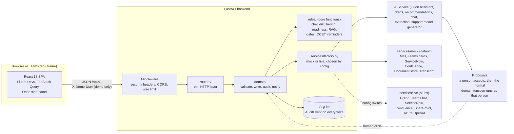

# Orion – Operate Readiness Agent (demo)

Orion is a working demo for Shell Mobility's Supportability & Transition (S&T) team.
It has two parts: an **Operate Readiness workspace** (the system of record and workflow for every transition) and an
**AI agent** (the Orion panel) that drafts messages, recommends actions, chases owners and generates the support model.
Every external system and every AI capability is a deterministic mock behind an interface, so real services can be added
later without changing the screens or the business rules.

> **Golden rule: Orion only drafts and proposes. A permitted person decides.** (BR-050)
> Orion never changes a status, applicability, tier, evidence acceptance, condition, approval or gate decision.
> Every write is audited with an actor type: **Human**, **Workflow rule**, **Orion agent** or **System**.
> Screens label output as "Orion agent" (AI badge) or "Workflow rule".

| Read this | For |
|---|---|
| [`docs/DEMO_SCRIPT.md`](docs/DEMO_SCRIPT.md) | The presenter's script with exact clicks (about 25 minutes) |
| [`docs/REQUIREMENTS.md`](docs/REQUIREMENTS.md) | Behaviour spec (source of truth) |
| [`PLAN.md`](PLAN.md) | Milestones, status, every assumption (A-01 to A-96), open questions |
| [`seed/`](seed/) | Seed data (source of truth for data). [`reference/`](reference/) is the client prototype, used only to cross-check form labels. |

---

## 1. How to run

**You need:** Python 3.14 or newer (built and tested on 3.14.7; target 3.15.2, only a venv rebuild, A-01) and
Node.js 22.12 or newer with npm.

### Windows (PowerShell), from the repository root

```powershell
scripts\setup.ps1                  # creates backend\.venv, installs backend and frontend packages
scripts\dev.ps1                    # API on :8000 and web app on :5173, each in its own window
```

Open `http://127.0.0.1:5173`. If port 5173 is taken by another app, use `scripts\dev.ps1 -WebPort 5174` and open that port instead.
API docs: `http://127.0.0.1:8000/docs`. The database is created and seeded on first start (18 transitions).
Pick a user on the login page: there is no password.
If you use a web port other than 5173, set `APP_BASE_URL=http://127.0.0.1:<port>` in `backend/.env`, otherwise links in e-mails and cards point at 5173.

### Git Bash

```bash
cd backend
python -m venv .venv
.venv/Scripts/python.exe -m pip install -r requirements-dev.txt -c constraints.txt   # includes pytest and the pinned versions
.venv/Scripts/python.exe -m uvicorn app.main:app --reload --port 8000     # terminal 1, stays in backend/
cd frontend && npm install && npm run dev                                  # terminal 2, from the repo root
```

macOS and Linux: `make setup`, then `make dev` (the venv Python is `backend/.venv/bin/python`).
`npm run dev` serves the web app on `127.0.0.1:5173` and proxies `/api` to the API (`ORION_API_URL`, default
`http://127.0.0.1:8000`). Another web port: `npm run dev -- --port 5174`.
A second copy next to a demo (A-66): start its API on another port with its own `DATABASE_URL` and `STORAGE_DIR`,
set `ORION_API_URL` to it, and set `APP_BASE_URL` to its web address.

### Tests and checks

| Command | What it runs |
|---|---|
| `cd backend && .venv\Scripts\python.exe -m pytest` | Backend tests (rules, API, permissions, services, security and the full demo storyline). Takes several minutes. Quick check: `.venv\Scripts\python.exe -m pytest tests/test_rules_gates.py`. |
| `cd frontend && npm run build` | TypeScript strict type-check (`tsc -b`) and production build |
| `cd frontend && npm run lint` | eslint |
| `scripts\test.ps1` (Windows) or `make test` and `make lint` | All of the above, plus ruff and black, in one go |
| `scripts\reset.ps1` or `make reset` | Re-seed the database (stop the API first). If the API is running, use **Admin -> Demo controls -> Reset demo data** instead. |
| `scripts\audit.ps1` or `make audit` | `pip-audit` and `npm audit` |

After changing a backend response model run `make openapi` or `scripts\gen-api.ps1` to regenerate the frontend API types.

### Settings (`backend/.env`, copy from `backend/.env.example`)

| Key | Default | Meaning |
|---|---|---|
| `DEMO_MODE` | `true` | Shows **Demo controls** in Admin. Set `false` for anything that is not a demo. |
| `AI_MODE` | `mock` | `mock` or `live`. `live` is not built: the factory logs a warning and uses the mock. |
| `MAIL_MODE` | `mock` | `mock` or `graph`. `graph` selects a stub that raises "not implemented". |
| `ORION_MAILBOX` | `orion-noreply@example.com` | Sender of Orion mail |
| `REMINDER_JOB_ENABLED` | `false` | `true` runs the reminder engine every 15 minutes |
| `SEED_DATE` | empty | Fixed "today" (YYYY-MM-DD) for repeatable demos |
| `DATABASE_URL` | `sqlite:///./orion.db` | SQLAlchemy URL. Relative SQLite paths resolve against `backend/`. |
| `STORAGE_DIR` | `backend/app/storage` | Uploads and generated PowerPoint files |
| `MOCK_DELAY_MS` | `600` | Simulated latency of mock services (`0` is snappier) |
| `SCHEMA_AUTO_RESET` | `true` | A database whose schema version differs from the code is dropped and re-seeded at startup. `false` = refuse to start with an error. |
| `APP_BASE_URL` | `http://localhost:5173` | Deep links in e-mails and cards. Change it with the web port. |
| `CORS_ORIGINS` | `["http://localhost:5173","http://127.0.0.1:5173"]` | Allowed browser origins |
| `MAX_UPLOAD_MB` | `25` | Upload limit (413 above it) |
| `AZURE_OPENAI_ENDPOINT`, `AZURE_OPENAI_KEY`, `AZURE_OPENAI_DEPLOYMENT` | empty | Only for `AI_MODE=live` |

---

## Words you will meet

| Word | Meaning |
|---|---|
| OR | Operate Readiness: getting a project ready to be run by operations |
| OCET | The operating cost estimate (5-year run-and-maintain), approved by Planner then OLM |
| AtD / AtO | Agreement to Deploy / Agreement to Operate: the two gate decisions |
| SG0 to SG6 | The one gate model: SG0, SG2, SG3, AtD, Hypercare, AtO, Closure |
| IRM | Compliance approver (information risk) |
| OLM | Operations lead who approves OCET, support model, AtD and AtO |
| Lens | Business, Technical or Compliance view of the checklist |
| Golden set | The expected extra items for a portfolio |
| Flagship | The main demo transition, TR-0001 (Mobility Knowledge Agent) |

---

## 2. Demo users

All fictional. On the login page click a name. To change user at any time: top-right **user menu -> Switch user -> name**.

| Id | Name | Role | What they show in the demo |
|---|---|---|---|
| U01 | Asha Menon | OR focal (labelled A) | Main presenter, owner of the flagship. Starts transitions, launches the assessment, sends drafts, submits OCET and support model, records gate decisions. |
| U02-U09 | Rahul Iyer, Neha Kulkarni, Vikram Shah, Priya Nair, Arjun Rao, Kavya Reddy, Sanjay Pillai, Divya Joshi | OR focal (labelled B to I) | Own other seeded transitions. Same rights as Asha, on their own transitions only. |
| U10 | Daniel Brooks | Project manager | Project manager on the flagship TR-0001 (and on a new transition if chosen at intake). Standby user. |
| U11 | Mei Lin | Architect | Enters the missing OCET cost. First approver of the support model. |
| U12 | Sofia Garcia | OLM | Approves OCET (step 2), the support model (step 2) and AtD (step 1). Receives the "Ready for AtD" request. |
| U13 | Tom Becker | Planner | First approver of OCET. |
| U14 | Fatima Khan | IRM | Confirms the AI tier. Approves exception EX-01 and the second AtD step. The only IRM. |
| U15 | Laura Evans | Leadership | Read-only portfolio view. |
| U16 | Playbook Admin | Admin | Admin page and Demo controls (reset, fast-forward, set today, run reminder engine). |

A role is not enough: a person must also be assigned to that role **on that transition** (`backend/app/access.py`, A-75).
A disabled button always says why in its tooltip.

---

## 3. Architecture



### Where things live

| Folder | What is there |
|---|---|
| `backend/app/routers` | HTTP only: parse, check permission, call a domain function, return a response model |
| `backend/app/domain` | Everything that touches the database: writes, audit events, notifications, Orion proposals |
| `backend/app/rules` | Business rules as pure functions with unit tests (no database, no I/O) |
| `backend/app/services` | `interfaces.py` (one Protocol per external system), `factory.py` (the only place that picks mock or live), `mock/`, `live/` (stubs), `cards/` (Adaptive Card JSON) |
| `backend/app/schemas` | Pydantic request and response models |
| `backend/app/seed`, `seed/` | Idempotent loader, and the JSON seed files it reads |
| `frontend/src/features` | One folder per area (workspace, gates, ocet, supportModel, orion, drafts, admin, ...) |
| `frontend/src/components` | Shared UI |
| `frontend/src/api` | The single typed client (`client.ts`) and generated API types |

The UI only talks to `/api/v1`. Filters and tabs live in the URL, so every page has a stable deep link. The app runs in an
iframe (no pop-ups; downloads use fetch plus a temporary link). When Orion suggests a change it stores a proposal;
accepting it (`POST /orion/proposals/{id}/accept`) is a human request that runs the normal domain function as the signed-in user.

---

## 4. Mock to real service mapping (spec section 10)

Each live class already exists as a stub in `backend/app/services/live/`; its docstring names the real call.
`services/factory.py` is the only place that chooses, using `backend/app/config.py`. Today two switches exist
(`MAIL_MODE` and `AI_MODE`); for the others the stub is ready and the change is one line in `factory.py`.

| Interface | Real service | Demo today | Selected by |
|---|---|---|---|
| `MailService` | Microsoft Graph (`Mail.Send`, shared mailbox, `POST /users/{mailbox}/sendMail`) | Outbox row, logged | `MAIL_MODE`: `mock` or `graph` (stub raises "not implemented") |
| `NotificationService` (Teams) | Teams bot and Adaptive Cards (Azure Bot Service; `Action.Execute` calls the Approvals API) | Outbox row with the card JSON, actions disabled | Mock only; stub in `live/notification.py` |
| `ServiceNowService` | ServiceNow Table API (`pm_project`) | Looks up PRJ0052210 and PRJ0049920 in `seed/mock_external_systems.json` | Mock only; stub in `live/servicenow.py` |
| `ConfluenceService` | Confluence REST API (`body.storage`) | Canned pages matched on the URL | Mock only; stub in `live/confluence.py` |
| `DocumentStore` | SharePoint (Graph drive). Evidence holds links, not copies. | Files in `STORAGE_DIR`, fake `sharepoint.example` link | Mock only; stub in `live/document_store.py` |
| `AIService`, `SupportModelGenerator`, `TranscriptService` | Azure OpenAI / AI Foundry (chat, tool calling, multimodal), Teams or Stream transcripts, Azure AI Speech | Templates filled with real data, keyword intents, deterministic extraction. If the transition name or the Confluence URL contains the whole word "VOC" or "Medallia" (any case), it gives the Medallia VOC landscape; otherwise a generic one. | `AI_MODE`: `live` is accepted but logs a warning and uses the mock. Endpoint, key and deployment go in `AZURE_OPENAI_*`. |

Rules and numbers always stay in `rules/`; AI only words them, and a live AI must fall back to the mock on any error.
The PowerPoint export is real (python-pptx, 5 slides; the "PTIV ORB" template is still a placeholder).

---

## 5. Security placeholders (demo level, NFR-10)

| Area | In the demo | For production |
|---|---|---|
| Sign-in and roles | Pick a user, no password; the `X-Demo-User` header, isolated in `deps.get_current_user` (A-23). Permission matrix in `permissions.py`. | **Entra ID single sign-on** plus role-based access from Entra groups. Only `get_current_user` changes. |
| Per-transition access | Role plus assignment on that transition; Orion proposals inherit it (A-75) | Keep |
| Secrets | None in code; `.env.example` only | **Azure Key Vault** for Azure OpenAI, Graph and ServiceNow credentials |
| Data classification | Synthetic data | Classify OCET and architecture data as **Confidential**; apply labels and retention |
| Audit | Every write has an `AuditEvent` (actor type, before and after values) | Ship events to the client's log platform |
| Orion as an AI agent | Designed as a **Tier 2** agent: internal, bounded, advisory, no writes to systems of record | Register Orion in the AI inventory; confirm the tier with the IRM |
| Web hygiene (A-24) | CORS allow-list, `X-Content-Type-Options`, `Referrer-Policy`, CSP `frame-ancestors` for self and Teams (not `X-Frame-Options: DENY`), upload limits and filename checks, sandboxed draft preview, no stack traces in errors, pinned dependencies | Client VAPT; review headers behind the gateway; re-run `scripts\audit.ps1` every release |

---

## 6. Admin

The **Admin** page (Playbook admin only) has 8 sections in a menu on the left. An admin changes the following without code (A-85):

| Section | What an admin changes there |
|---|---|
| **Checklists & items** | The checklists and the items in them: title, gate, area, which tiers and project types they apply to. |
| **Project types** | Add or edit a project type: which checklists it uses, whether it needs tiering, an AI profile or eval metrics, and which form fields are required. |
| **Portfolios** | Add or edit a portfolio (mobility landscape category), its golden-set checklist and whether it needs sites. |
| **Forms & dropdowns** | The labels, help text, order and visibility of the New transition form fields, extra custom fields, and the values in every dropdown list. |
| **People & permissions** | Add or deactivate people, rename roles, and decide what each role may do (permission grid). |
| **Rules & thresholds** | The tiering questions and tier definitions, approval chains, reminder rules, thresholds and AI evaluation targets. |
| **Messages** | The wording of Orion drafts, e-mails and Teams cards. |
| **Demo controls** | Reset demo data, fast-forward the flagship, set today's date, run the reminder engine (only when `DEMO_MODE=true`). |

The gate names, the three lenses (Business, Technical, Compliance) and the Orion guardrails stay fixed.

---

## 7. Open points for the client (spec section 17, PLAN.md section 6)

Questions for the S&T team:

1. Which module is built first for real: the AI transition flavour or a business portfolio (for example GCC)?
2. Please confirm the lens per Framework activity and the final golden set per portfolio.
3. What are the tier-specific evaluation thresholds?
4. Who signs AtD and AtO exactly (SOM, OR focal, IRM)? Is ERS the same as IRM?
5. OCET: default growth rules, currency, horizon (5 or 6 years); must the Excel template be kept?
6. Please share the support model PowerPoint master ("PTIV ORB" format).
7. Access for the real build: ServiceNow API, Confluence, SharePoint site, Orion shared mailbox (Graph), Azure OpenAI / Foundry, Teams app approval.

Assumptions built into the demo (all configurable, details in PLAN.md section 5): the 72 Framework activities apply to every
transition; lens per activity is a suggested mapping; one gate model (SG0, SG2, SG3, AtD, Hypercare, AtO, Closure);
approval chains are OCET = Planner then OLM, AtD = OLM then IRM, AtO = IRM then OLM, support model = Architect then OLM;
evidence lives in SharePoint (mocked); eval targets are the same for every tier; Orion is a Tier 2 agent.
Still to confirm: whether regenerating the support model after it is Agreed should reopen the linked checklist items (today they stay Complete, A-70), Compliance items stay with the IRM (A-10),
SG3 shows open Compliance items as information (A-12), an approved exception counts as done (A-09),
who approves the CISO/BISO step in production (A-57).

---

## 8. Known limitations of the demo

- Every integration and the AI are **mocks**: the same input gives the same output. The Outbox shows the e-mail and Teams card that would be sent.
- **SQLite** and a local `storage/` folder. A database whose schema version differs from the code is dropped and re-seeded at startup (`SCHEMA_AUTO_RESET`).
- **Demo clock:** Admin can set "today" and fast-forward the flagship. Both exist only when `DEMO_MODE=true`; switch them off in any shared environment.
- **No real sign-in:** anyone can pick any user.
- Not built: Teams preview page (approvals are done in the Approvals inbox, A-13), risk acceptance (conditional AtO), OCET Excel export, Support Model Retriever, live LLM mode.
- Seed data is synthetic and golden sets are approximate. Readiness for very small scopes cannot always hit the spec's plus or minus 3 points (A-37).
- The CISO/BISO step of the exception chain has no real approver: in demo mode the IRM approves it, labelled "(mock)" (A-57). Evaluation results are imported from sample data, not from a real test run. Gate history is seeded only for the flagship (A-20).
- Stack notes: React Router 7 is used instead of v6 and Python 3.14 instead of 3.11 (A-01, A-43).
